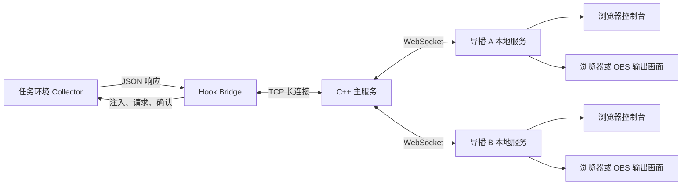

# DCS 电竞 UI

通过浏览器呈现 DCS 比赛信息，支持多个导播端分别控制输出画面。

Windows 用户可运行构建生成的离线安装包 `dist/installer/DCS-Esport-UI-Setup-0.8.0.exe`：原生外层自动检测 .NET Framework 4.8 或更高版本，缺少时调用内置微软离线安装包（需要 Windows 管理员授权，不强制重启）。内置 Node.js，支持从注册表识别“保存的游戏”、选择多个 DCS 配置目录、首次账号设置，以及启动前自动检查与修复。修复保留账号和画面设置。源码仓库不包含安装包及第三方运行库，构建步骤见 [安装与自动修复](docs/implementation/installer.md)；操作指南见 [使用说明 PDF](output/pdf/DCS电竞UI使用说明.pdf)。

当前版本：C++ 0.4.1、导播 0.8.0、HOOK 0.3.2 / 采集器 0.1.5。已提供多导播鉴权、订阅、中文控制台和 OBS 透明输出，两侧选手标牌采用油量条，中央留给游戏画面。支持自定义队伍与选手池、比分/队标、来袭导弹提示、实时开关、取消预览、元素拖动及自适应缩放。

已按要求移除原生状态栏控制、F2 自动跟随和底部选手特写。默认提供比赛直播、紧凑阵容两个布局与十六项独立开关；旧特写画面迁移为比赛直播并保留其他配置。单文件 HOOK 继续负责任务注入、1 Hz 采集、事件预编码、ACK、断线重连及结束补拉，不再加载 GUI 状态栏脚本。详见 [导播使用说明](docs/implementation/director.md)。

本机启动与异机 HTTPS/WSS 部署见 [导播使用说明](docs/implementation/director.md)。2026-10-17 最终实机验证：32 架飞机、结束前 11 发导弹，35 条事件连续无重复并全部到达浏览器；101 个快照间隔中位数 1.008 秒，协议错误 0。任务环境在最终 ACK 前消失时，正确显示 unverified，不伪报清理成功。完整证据见 [实施进度与验收](docs/implementation/progress.md)。

部署只需运行 `python tools/package.py` 生成的 `dist/DcsEsport/Scripts/Hooks/DcsEsportHook.lua`，放入实际 DCS 配置目录的 `Scripts/Hooks`。它已内嵌 JSON、桥接、文件输出和任务采集器源码，由 Hook 在任务开始后注入任务环境；不需要额外部署任务脚本或配套模块文件。配置位于生成文件顶部的 CONFIG 区域。

## 设计文档

| 文档 | 内容 |
| --- | --- |
| [任务环境与 Hook 架构](docs/architecture/mission-hook.md) | 职责、注入流程、实体身份、飞机与导弹采集、事件缓存、确认与生命周期 |
| [任务环境与 Hook JSON 协议 v1](docs/protocol/mission-hook-v1.md) | 操作、JSON 字段、数据类型、事件日志、状态分片、错误及交互示例 |
| [实现、部署与验证](docs/implementation/mission-hook.md) | 目录、打包安装、本地测试、诊断文件、手工确认与实机验收 |
| [C++ Web 服务器实施计划](docs/architecture/web-server-plan.md) | 网络接入、内存 ACK 契约、多导播订阅、鉴权、恢复及实施验收 |
| [Hook → 主服务器协议 v1](docs/protocol/hook-server-v1.md) | TCP 帧、消息字段、memory ACK、恢复和只读 HTTP |
| [主服务器运行说明](docs/implementation/server.md) | 编译、凭据、启动/停止、单文件部署、查询及联调 |
| [浏览器与导播协议 v1](docs/protocol/browser-v1.md) | 登录、角色、源权限、WS 游标、SSE、本地鉴权、输出字段 |
| [导播使用说明](docs/implementation/director.md) | 控制台、OBS、账号、多个导播服务及 HTTPS/WSS |

## 当前实现

- [任务环境采集器](src/mission/collector.lua)：飞机、逐发导弹、目标观察、事件日志、ACK、冻结快照分页及生命周期。
- [Hook 桥接](src/hook/bridge.lua)：分阶段注入、返回值兼容探测、限频拉取、分页组装、显式确认及背压。
- [DCS Hook 引导模板](src/hook/DcsEsportHook.lua)：从文件内嵌源码创建模块、注册回调；通过构建生成单文件 Hook，诊断文件默认关闭。
- [Hook TCP 传输](src/hook/transport.lua)：本机非阻塞连接、分帧、按源确认和重发。
- [C++ 主服务器](src/server/main.cpp)：Boost.Asio TCP、Boost.Beast HTTP/HTTPS/WebSocket、账号授权和有界内存仓库。
- [导播本地服务](src/director/server.mjs)：上游会话、自动重连、本地控制权限、每画面配置及 SSE 分发。
- [控制台](src/web/control.html)与[输出页](src/web/output.html)：中文深色电竞界面、独立功能开关、两个布局和 OBS 输出。
- [本地测试](tests/run.py)：使用有状态 DCS API 模拟环境验证逻辑，不代替游戏内测试。

配置并启用网络后，匹配的 C++ `ackMode=memory` 确认会自动交回采集器。它仅表示本次服务器进程已接收，不保证进程退出后的恢复。通用 Hook 包默认关闭网络，需按服务器运行说明生成带本机凭据的单文件部署包。本地 JSON/JSONL 仅用于可选诊断，不参与 ACK。

## 最低数据要求

输出数据必须能够回答：

1. 飞机当前速度是多少，速度采用什么口径。
2. 飞机当前油量读数是多少，单位及换算依据是什么。
3. 飞机当前携带哪些武器，各有多少。
4. 飞机当前是否由玩家控制，玩家名称是什么。
5. 每一发被捕获的导弹是谁发射的，包括发射时的飞机和玩家信息。
6. 如果 DCS 接口返回目标，这枚导弹的目标是谁，目标观察是否已经变化。

以上均为必需的协议字段。DCS 暂时无法提供值时，必须返回明确的未知状态、时间和质量信息；不得省略字段或用零、空列表、`false` 冒充正常数据。

速度 v1 明确提供世界速度矢量的三维模长，以及水平地速；不承诺其等于座舱指示空速。油量至少提供 DCS 燃油 API 的原始比例，绝对质量仅在换算经过验证时提供。武器清单表示当前可查询的弹药类型和数量，不承诺完整挂点、吊舱或副油箱布局。

## 总体链路

图中全部链路已实现并通过实机测试；主服务至导播使用 WS/WSS，导播至本机浏览器使用 HTTP + SSE。账号密码不会保存到导播配置，上游会话不会发送给输出页。
