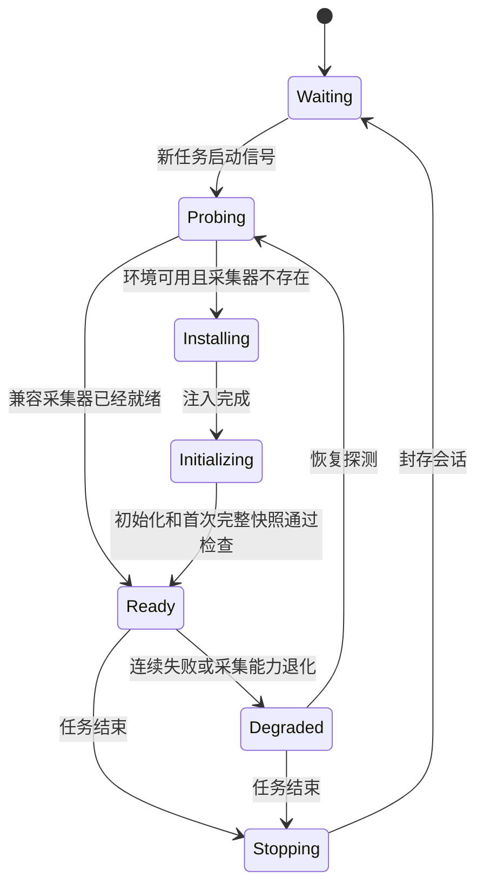
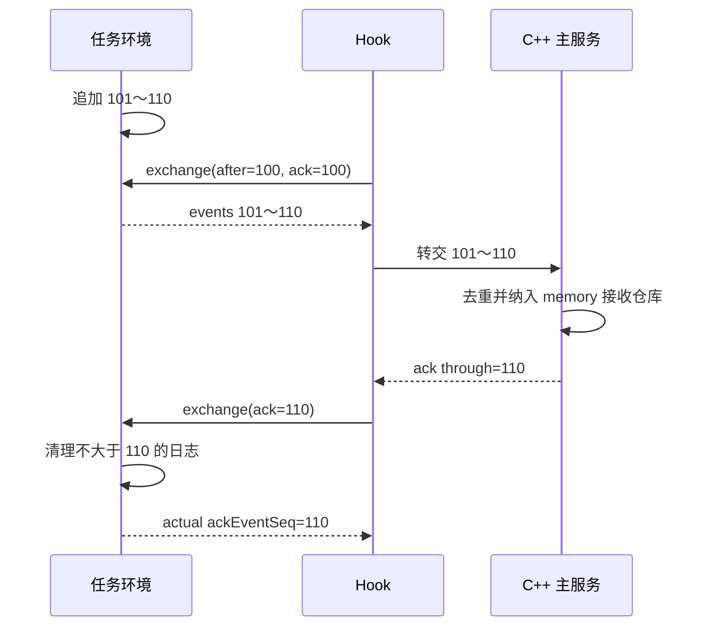

# 任务环境与 Hook 架构

状态：设计草案，已取得首轮 DCS 实机采集记录，完整实机验收尚未完成。文档日期：2026-10-16。协议版本：1。

字段及交互的规范定义见 [JSON 协议 v1](../protocol/mission-hook-v1.md)。本文描述职责、时序和设计原因；若字段示例与协议表有出入，以协议表为准。

## 1. 范围与最低要求

采集器部署在 DCS 比赛服务器的任务环境，Hook 在同一 DCS 实例中运行。一个任务环境仅对应一个数据消费者 Hook；多个导播端通过 C++ 主服务共享采集结果。

本阶段必须提供：

| 需求 | 输出约定 |
| --- | --- |
| 飞机速度 | 原始世界速度矢量、三维速度 `speedMps`、水平地速 `groundSpeedMps`，带采样时间 |
| 飞机油量 | `fuel.ratioRaw`；可用时提供参考容量及经过验证的质量换算；明确来源、质量状态和时间 |
| 当前武器 | `armament.items` 中的当前弹药类型、显示名称、分类和数量 |
| 是否玩家 | `occupancy.isPlayer`，以及当前 `playerName`；未知不能视为 AI |
| 每发导弹的发射者 | 每发独立 ID；冻结发射时的发射平台、玩家名称、玩家标识和发射时间 |
| 导弹目标 | 冻结首次目标观察，并持续输出当前目标观察；目标对象可独立于飞机采集范围存在 |

必需字段意味着必需尝试采集、必需输出状态并纳入验收，不意味着 DCS 的每次调用都必然成功。不可用时返回 `null` 和明确的质量信息，并报告采集能力退化。

本文不涉及比赛积分规则、全轨迹历史记录、浏览器布局、导播权限以及座舱专用数据导出。0.2.0 已新增独立的 [主服务网络协议](../protocol/hook-server-v1.md)。

## 2. 双方职责

| 职责 | 任务环境 Collector | Hook Bridge |
| --- | --- | --- |
| 环境初始化 | 创建数据结构、处理器和调度器 | 环境探测、版本检查、注入及重试 |
| DCS 对象访问 | 持有对象引用，安全调用采集 API | 不持有任务对象，不逐实体远程调用 |
| 采样 | 根据仿真时间采样并更新缓存 | 统一限频拉取 |
| 事件 | 接收 `onEvent`，规范化并入队 | 批量拉取和转发 |
| 确认 | 校验 ACK，删除已确认日志 | 转交 C++ 在已协商模式下的连续接收确认；0.2.0 为 memory |
| 网络 | 不承担 | 非阻塞连接 C++，重连和有限缓存 |
| 时间 | 事件时间、采样时间、仿真时间 | 接收真实时间、暂停和连接状态 |
| 业务规则 | 不承担 | 交给 C++ 主服务 |

任务环境不依赖文件系统或网络操作。发布时将 JSON、Hook 模块和任务采集器源码全部内嵌进一个 `DcsEsportHook.lua`，仅部署到 `Scripts/Hooks`。Hook 通过适配后的跨环境调用把内嵌源码注入任务环境；不要求额外部署任务脚本，不从配套文件读取采集器源码。开发源码仍分模块维护，由构建工具合并。

## 3. 采集器组成

采集器使用独立命名空间 `DcsEsportCollector`，包含：

- JSON 编码器和解码器；JSON 作为数据解析，不作为 Lua 执行。
- 统一协议入口及参数、版本、会话校验。
- 对象身份注册表：对象引用、DCS 标识、本系统实体 ID 的关联。
- 飞机与活跃导弹注册表。
- 状态采样器及只读的最新状态缓存。
- 独立的 `world.addEventHandler` 处理器。
- 可重读事件日志、缺失区间和确认游标。
- 单消费者使用的一份冻结分片快照。
- 运行健康度及覆盖范围信息。

对象引用只在采集器内部保存。输出快照和事件仅包含普通数据，不保留 Lua userdata、函数或原始 DCS 事件表。

## 4. 注入与初始化

### 4.1 生命周期

`Ready` 表示协议与采样可用，不代表所有机型、字段或历史事件均已完整获取。覆盖范围和质量状态仍需单独检查。

### 4.2 安装顺序

1. Hook 根据任务生命周期识别一次新的任务运行，生成唯一的 `missionSessionId`。同名任务重开也换 ID。
2. 在适当的 DCS 回调上下文中有限重试探测。检查真正任务脚本环境中的 `world`、`timer`、`coalition` 等能力，并验证短字符串往返。不能仅因跨环境函数返回成功就认定到达了正确环境。
3. 探测命名空间、采集器版本、协议版本及现有会话信息。
4. 不存在采集器时，由 Hook 分配 `collectorEpoch` 并注入完整采集器。
5. 发送 `initialize`。该次安装重试始终使用相同 `collectorEpoch`，不能因为响应丢失就重置采集器。
6. 校验配置，先注册事件处理器，记下 `captureStartedSimTime`，再扫描已有飞机。
7. 扫描和事件统一通过注册表去重；扫描得到的对象标为 `initial_scan`，不伪造出生事件。
8. 建立首次完整快照，记录 `baselineCompletedSimTime`，返回实际配置、能力及覆盖范围。
9. Hook 校验完整快照及最低数据要求，进入正常拉取。字段不全时标记退化，不能把空记录视为正常就绪。

Hook 在任务环境尚未就绪时分步重试；等待通过未来回调调度，不在当前 DCS 回调内阻塞休眠。

### 4.3 幂等、接管与重建

- 同一会话、同一 epoch、同一配置的重复初始化返回现有实例，不重建调度器、不重复注册事件、不清空缓存、不重置序号。
- 相同配置版本对应不同内容属于冲突，返回错误；动态修改走 `configure`。
- Hook 重启后若发现同任务的兼容实例，先接管其会话和 epoch，并与 C++ 保存的源身份核对，不立即重建。若无法证明当前 DCS 任务与旧源相同，报告连续性未知，不能靠任务名称猜测。
- 新任务有新的 `missionSessionId`。相同任务内采集器丢失后重建，使用新的 `collectorEpoch`。
- 版本不兼容时保留现有数据并报错，不自动覆盖仍含未确认事件的采集器。
- 受控停用先尝试排空日志，后注销处理器并让定时器停止。停止采样不自动清空仍可读取的事件日志。

### 4.4 DCS 版本适配

Hook 负责适配实际 DCS 版本的执行上下文、跨环境调用路线和返回值。路径可能涉及 `net.dostring_in()` 以及 `a_do_script()`，以实机验证为准。

业务协议始终返回一个 JSON 字符串。JSON 解决多字段打包；不能假设它自动修复所有版本的返回值错位或空返回问题。安装前的短字符串探测和安装后的 JSON 往返校验均为必需步骤。

协议 v1 不开放任意 Lua 执行操作。安装源是受控部署内容；业务请求只允许已定义操作。

## 5. 实体身份与对象引用

完整实体身份为 `(missionSessionId, collectorEpoch, entityId)`；完整事件身份为 `(missionSessionId, collectorEpoch, eventSeq)`。

- `entityId` 由采集器分配，不直接使用单位名称或 DCS ID。
- 同名飞机重生获得新 ID；重复出生通知不得给同一存活实例分配多个 ID。
- 飞机对象不变而玩家更换时，实体 ID 不变，更新占用信息。
- DCS ID 可能复用，必须结合出生、存在性及实例登记管理。
- DCS 对象可由不同 Lua 包装表表示。0.1.1 内部优先用引擎 `id_`/`getObjectID` 关联，输出可选 `runtimeObjectId`，与 getID 的 `dcsObjectId` 分开；无法识别的匿名包装对象不按表地址制造目标变化。
- 导弹每次发射获得独立 ID，不能按导弹型号或发射平台聚合成一个实体。
- 发射者和目标即使不在完整遥测范围，也登记最小引用身份并嵌入 `ObjectRef` 快照；仅有引用不意味着会出现在完整飞机状态集合中。
- 历史事件中的发射者快照不随当前飞机的玩家、名称或存活状态变化而改写。

`ObjectRef` 中保留实体 ID、DCS ID、对象名称、型号、阵营及玩家信息。无法取得个别属性时保留 `null`，质量状态说明缺失原因。

任务环境玩家名称用于展示，不能作为账号唯一键。UCID、联网玩家 ID、多座席乘员与服务器身份映射留给 Hook/主服务后续补充。v1 的 `isPlayer` 表示当前任务 API 可观察到的玩家控制状态，不承诺完整乘员列表。

## 6. 飞机采集

### 6.1 发现与校验

默认扫描配置阵营中的已存在、已激活固定翼飞机；可配置直升机。未激活任务模板不当作活跃飞机。

安装时初始扫描，运行时处理出生事件，并默认每 5 仿真秒重新扫描一次。事件和扫描使用同一身份注册表。单次扫描遗漏不等于对象死亡。

### 6.2 速度

读取世界速度矢量 `velocity` 并在任务环境输出直接可消费的数值：

- `speedMps = sqrt(vx² + vy² + vz²)`，三维世界速度大小。
- `groundSpeedMps = sqrt(vx² + vz²)`，水平地速。
- 两者与 `velocity` 使用同一有效采样，单位为米/秒。
- UI 可换算为 km/h（乘 3.6）或节（乘约 1.94384449）。

`speedMps` 不是指示空速 IAS，也不直接宣称是真空速 TAS。v1 不依赖座舱专用导出。位置、姿态基向量和是否在空中默认随 1 Hz 飞机运动采样刷新。

### 6.3 油量

每架飞机必须输出独立 `fuel` 数据块：

- `ratioRaw`：DCS `getFuel()` 的原始比例，不做 0～1 强制截断。
- `referenceInternalCapacityKg`：可读取时保留机型描述的内油参考容量。
- `massKgEstimate`：仅当对应版本、机型、油箱配置的换算已验证时给出，并标记估算。
- `massMethod`：说明采用何种换算；未经验证时为 `unavailable`，质量估算为空。
- 质量状态和最后有效采样时间。

原始比例可以作为“DCS 燃油比例”展示，但不能无条件命名为“全部油箱剩余百分比”。不同机型及外挂油箱的具体口径必须实测。若显示比例乘 100，应使用明确标签并保留大于 100% 的原始结果，不能自动截断。

v1 的最低要求是可解释、可显示的原始比例读数；绝对千克数不是未验证情况下的保证项。

### 6.4 当前武器

通过当前 `getAmmo()` 结果整理 `armament.items`，每项输出类型标识、名称、分类及当前数量。默认保留 API 返回的每一项及其完整计数，不在缺乏可靠类型键时合并不同武器。

- 有可靠 `desc.typeName` 时作为原始类型；同时保留显示名及可用的 `wsType`。
- `weaponKey` 优先使用可靠类型名，其次使用 `wsType`；都缺失时给采集器内的未知类型键并标记退化，不能把不同未知弹药强行合并。
- 不使用本地化显示名称作为稳定类型键。
- `[]` 仅表示成功查询且当前没有 API 可见弹药；查询失败时 `items` 为 `null`。
- 发射、补给、换装、玩家进入等相关事件把清单标为待刷新，在后续调度点读取，并用低频查询兜底。
- `getAmmo()` 的空值含义需按版本适配确认，不能把未验证的空返回直接当作空弹药。

该清单回答“目前有什么类型的弹药、各有多少”。它不等于完整挂点图；挂架、副油箱、吊舱、诱饵余量及每一挂点位置不在 v1 最低保证内。

### 6.5 玩家标识

`occupancy.isPlayer` 是明确字段，不让下游通过名称字段是否存在自行猜测。

- 成功取得当前玩家名称：`true`，保存名称。
- API 成功报告没有玩家：`false`，名称为 `null`。
- API 失败或语义不明：没有历史值时为 `null`；有历史值时可保留最后值但标记 `stale`。
- 玩家进出、接管事件触发刷新，并通过低频采样校验。

### 6.6 异常与移除

单字段失败不丢弃整架飞机；保留其余有效数据。暂时读取异常保留最后有效值和时间并标记陈旧。明确对象不再存在时从活跃集合移除并记 `entity_removed`。

若连续失败而无法确认对象存在性，可停止正常遥测并记 `tracking_lost` 原因，不能把它写成死亡。`pilot_dead`、`crash`、`dead` 和对象移除分别保存，避免把飞行员状态与飞机对象生命周期混为一谈。

## 7. 导弹采集

### 7.1 发射登记

1. 收到 `S_EVENT_SHOT`，读取武器对象及描述。
2. 使用运行时的武器分类过滤导弹；默认 `missileScope=all`，包括配置阵营中的空空、空地和防空等导弹，避免漏掉攻击参赛飞机的地面发射导弹。
3. 分配独立导弹 ID，登记 DCS 对象引用。
4. 先读取事件发起者；需要时以 `Weapon:getLauncher()` 补充。保留来源，冲突时标记质量异常而不静默改写。
5. 冻结发射者 `ObjectRef`，包括发射时 `isPlayer` 和 `playerName`；不能只保存飞机 ID 再查询当前驾驶员。
6. 尝试取得首次目标观察，记录初始位置和速度。
7. 写入 `weapon_fired`，加入默认 1 Hz 运动与目标观察采样。

若发射者身份无法取得，仍记录该发射，`launcher.status=unknown` 并标记最低数据不完整。不得归给最近飞机或按弹药变化猜测发射者。

发射回调中优先即时读取发射者的玩家状态，避免直接把 1 Hz 占用缓存当作发射瞬间的驾驶员。即时读取失败时可以保留历史值，但必须标记 `occupancyStatus=stale` 并保留真实观察时间。两来源给出不同发射平台时使用 `launcher.status=conflict`，保留候选，不当作已确认归属。

### 7.2 目标观察

目标使用 `TargetObservation`，有四种状态：

| 状态 | 含义 |
| --- | --- |
| `object` | 最近一次成功查询返回了对象，`object` 保存其简要快照 |
| `none_reported` | 最近一次成功查询没有返回对象，不能推断为实际不存在目标或已经失锁 |
| `unavailable` | 尚无有效观察，接口不支持或查询失败 |
| `stale` | 本次查询失败，保留历史观察；另带上次成功结果及时间 |

导弹中保存 `launch.initialTarget`、`targetObservation`、`lastKnownTarget`。首次观察和发射者不可被后续更新覆盖；当前目标每次成功查询按实际结果更新。成功查询从对象变成无返回时，当前 `object` 必须清空，旧目标只留在 `lastKnownTarget`。

两次成功观察的结果变化时写 `target_observation_changed`，表示观察变化，不宣称已获知实际导引头锁定状态。查询失败只更新质量及计数，不持续刷事件。

目标可能是飞机、地面单位、舰船或静态对象；完整 `ObjectRef` 允许脱离飞机状态集合解释。坐标制导武器没有返回对象时，不凭位置猜目标。采样间隔内发生且恢复的目标变化可能未被观察到。

### 7.3 结束与覆盖边界

- 明确对象不再存在时产生 `weapon_track_ended`，保留发射者、最后目标观察、最后位置及其采样时间。
- 原因没有直接证据时为 `unknown`；导弹消失不自动表示命中或击杀。
- 读取失败、资源限制和受控停止各有明确跟踪中断原因。
- 导弹即使在两次 Hook 拉取之间完成生命过程，发射和结束事件仍包含必要身份及初始/最后状态。
- 安装前已发射的导弹不承诺补全；初始化必须输出导弹覆盖开始时间。
- 每发导弹至少关联一次发射记录；无法取得武器对象但已知道发生发射时，保存不完整事件并报告能力退化，不伪造可跟踪导弹。

## 8. 调度与缓存

| 工作 | 初始频率/策略 |
| --- | --- |
| 飞机运动 | 1 Hz 仿真时间 |
| 导弹运动及目标观察 | 1 Hz 仿真时间 |
| 燃油、弹药、占用、生命值 | 1 Hz 仿真时间；相关事件触发待刷新 |
| 飞机注册表校验 | 每 5 仿真秒 |
| Hook 正常拉取 | 目标 1 Hz 真实时间，独立限频，不随导播数量增加 |
| JSON 编码 | 拉取时按数据快照编码，不在每个仿真帧编码 |

以上是可配置的压测起点，不是已验证性能保证。卡顿后仅采样当前状态，不集中补跑大量过期采样，不伪造过去时间的数据。采样可以分批，但各记录必须保留真实时间。DCS 脚本工作预算是软预算，不是可强制抢占线程的超时。

最新状态缓存只保存最新有效值；事件日志保存未确认事实；冻结快照仅用于一次完整状态传输。没有产生新采样时，快照保留原采样序号与时间。

暂停期间不伪造运动采样；Hook 的连接心跳与任务暂停状态单独处理。不能依赖仿真时间持续推进来保证真实时间下的网络重连。

## 9. onEvent 处理与事件日志

处理器独立注册，不覆盖任务已有处理器。正常处理流程：安全提取普通字段 → 更新注册表/刷新标记 → 分配日志序号并追加事件。

事件入口和各对象读取隔离异常；字段缺失保留 `null`，严重捕获错误增加健康度计数。只有成功形成一条规范化日志记录后才分配序号；序号前发生的捕获失败没有可推断的丢失区间，因此用 `captureErrorCount` 及覆盖退化报告。

| 来源 | 输出类型 |
| --- | --- |
| 出生 | `entity_born` |
| 发射 | `weapon_fired` |
| 命中、击杀 | `hit`、`kill` |
| 坠毁、死亡、单位损失 | `crash`、`dead`、`unit_lost` |
| 弹射、飞行员死亡 | `ejection`、`pilot_dead` |
| 起飞、着陆 | `takeoff`、`land` |
| 玩家进出 | `player_entered`、`player_left` |
| 对象跟踪移除 | `entity_removed`、`weapon_track_ended` |
| 两次成功目标观察不同 | `target_observation_changed` |

运行时探测事件常量；未知事件编号不导致回调中断。筛选发生在日志编号之前，日志序号不等于 DCS 原始事件编号。相关事件分别保存，比赛规则由 C++ 关联计算。

## 10. 确认、重传与溢出

### 10.1 两个游标

- `eventsAfterSeq`：Hook 已拉取/暂存的位置，决定下一批从哪里读。
- `ackEventSeq`：C++ 已连续接收的位置，决定任务环境可以清理哪里。0.2.0 明确协商 `ackMode=memory`，只保证当前 C++ 进程的内存接收；进程退出后已释放历史不可恢复。durable 模式尚未实现。

Hook 拉到 1050、C++ 只确认到 1020 时，可以继续读取 1051 之后，但任务环境仍保留 1021～1050。Hook 丢失自己的缓存后可以从已确认位置重读。

诊断输出不参与接收判定。默认实现以事件通过校验并进入 Hook 内存待确认队列为读取游标前进条件，随后通过非阻断观察器尝试输出 JSONL。诊断写入失败不触发事件重读，也不充当 C++ 确认。接收端须按 `(missionSessionId, collectorEpoch, eventSeq)` 幂等处理断线及进程重启后的重放。

### 10.2 确认规则

1. 会话和 epoch 均匹配；旧任务、旧采集器的 ACK 必须拒绝。
2. ACK 只前进；不大于已确认位置的重复值幂等接受。
3. 不得超过已经交付给 Hook 的最高日志终点。Hook 不得用 `latestEventSeq` 直接生成确认。
4. C++ 按完整事件身份去重，并连续处理；收到缺失区间后，先按协商模式保存缺失事实，才可跨过该区间确认。网络源身份另含绑定凭据的 instanceId。
5. 网络发送成功、Hook 读取成功或浏览器显示成功均不是任务环境的删除依据。
6. 响应丢失后重试合法；每次交互返回实际 ACK 位置。任务环境信任 Hook；网络适配器验证 connectionId、serverEpoch、ackMode 及完整 source。任务环境不负责网络身份校验，也不独立验证服务器存储状态。

### 10.3 有界缓存与丢失报告

默认事件日志上限为 10,000 条或 16 MiB，先达到哪个按哪个处理。条数和字节预算均需要实现；字节数按缓存数据的受控估算计，不宣称等于 Lua 运行时全部内存占用。

容量不足时淘汰最旧的未确认事件，并将其序号保留为 `buffer_overflow` 缺失区间。连续区间合并，缺失区间不再分配新事件序号。缺失记录自身使用有界表示，优先保持从 ACK 之后开始的连续缺失前缀，不得用无限增长的缺失列表替代原事件内存问题。

任务环境仍然通过新完整状态恢复“现在是什么”，但不能由快照补回丢失的击杀等历史事实。事件错误、缓存溢出、采集器重建和未排空结束分别报告，不能统一伪装成一次正常重连。

## 11. 完整状态与事件的一致性

v1 传完整活跃集合，不依赖消费者保存所有差分。快照可分页，但必须冻结普通数据，所有页具有相同 `snapshotId`、`scopeRevision` 和 `eventSeqAtCapture`。仅复制表引用不算冻结。

`eventSeqAtCapture` 是建立快照时已经处理进注册表的日志末端。它用于协调快照和后续状态事件，不用于确认日志。快照仍包含不同采样时间的字段，不承诺同一物理时刻的原子世界状态。

Hook 收齐所有页后才替换当前集合；漏页、失败或被放弃的快照不能清空旧实体。只对同一范围、具有完整清单覆盖的集合做“未出现即移除”。历史事件仍需处理一次，但不能用早于该快照水位的出生事件把已移除对象重新加入当前集合。

状态和事件可独立读取。积压时优先追赶事件，状态可以跳到更新快照。具体游标和预算行为见协议文档。

## 12. 生命周期边界

| 场景 | 行为 |
| --- | --- |
| C++ 断线 | 继续采集；任务与 Hook 缓存均有限；不能因 Hook 暂存就确认 |
| Hook 恢复 | 探测原实例，读取其 ACK，与 C++ 当前 epoch 接收游标核对后重读；服务重启时记录 memory 历史缺口 |
| 主服务数据回退 | 若其游标落后于任务环境已删除位置，报告不可恢复缺口，不假装能重传 |
| 任务暂停 | 保持旧采样时间，Hook 上报暂停，不判作运动采样正常推进 |
| 配置改变范围 | `scopeRevision` 增加，重新获取完整快照；缩小范围不是实体死亡 |
| 正常结束 | 任务环境先停止采样并冻结最终序号，Hook 在有限预算内分页补拉到该序号；未完成则保留 draining 和读取位置 |
| 任务环境销毁 | 无法再读取的尾部标记不完整，旧会话队列与新任务分开 |
| DCS 崩溃 | 尚未离开 DCS 的内存数据可能丢失；不保证绝对不丢事件 |

0.1.3 中，任务环境收到可用的 S_EVENT_MISSION_END 或处理 shutdown 后都保留可读取、可确认的最终日志。Hook 明确记录 tailComplete/tailReason，队列满时不靠自动 ACK 换取补拉空间。任务切换保留已经接收的旧源队列；新旧源共用总内存上限，旧源确认只释放对应的保留队列，不转交新任务环境。

## 13. 实施前验收清单

本节是后续验证要求，尚未执行。

| 场景 | 通过条件 |
| --- | --- |
| 目标 DCS 版本注入 | 在真正任务环境执行，短字符串和带中文 JSON 正确往返 |
| 初始化响应丢失及重试 | 仅一个事件处理器和一套调度器；序号和日志不重置 |
| 飞机速度 | 标量与同批矢量模长一致；水平速度口径独立；暂停不产生假采样 |
| 玩家与 AI | 有人、AI、换人、读取失败均可区分；发射时玩家信息不被换人覆盖 |
| 油量 | 有油、耗油、加油、不同外挂配置；未知不变成零；质量换算只在验证后启用 |
| 武器 | 初始挂载、发射、机炮、投弃、补给/换装后清单可解释；空与失败可区分 |
| 同型多发导弹 | 每发 ID、发射时间、平台和玩家归属分别保存 |
| 导弹目标 | 有目标、无返回、换目标、查询失败、范围外及非飞机目标正确区分 |
| 短寿命导弹 | 两次拉取间结束仍有发射及结束记录 |
| 重生与 ID 复用 | 同名新实体不接续旧生命周期 |
| 重传与确认 | 重传去重、ACK 响应丢失、越界 ACK 和旧 epoch ACK 行为符合协议 |
| 缓存溢出 | 返回准确缺失区间，按协商模式记录缺失后可继续确认 |
| 多页快照 | 不混页、不提前移除；实时采样继续；事件分页不被阻塞 |
| 卡顿、暂停、断线和换任务 | 时间语义明确、不补跑假历史数据、不混入旧会话数据 |
| 数据负载 | 测量采集与编码耗时、包大小及缓存峰值，再调整默认频率和上限 |

## 14. 参考依据与待验证项

- [ED：跨环境调用行为变更说明](https://forum.dcs.world/topic/376636-changes-to-the-behaviour-of-netdostring_in/)：说明接口历史变化；不是当前安装版本的实测结论。
- [跨环境返回值问题原始报告](https://forum.dcs.world/topic/376809-a_do_script-return-value-pass-thru-mangled-since-dcs-291812722/)：用于安排兼容性检查，不据此断言当前版本一定仍有同样问题。
- [MOOSE 项目维护的 DCS API 定义](https://flightcontrol-master.github.io/MOOSE_DOCS/Documentation/DCS.html)：对象速度、玩家、燃油、弹药、武器发射者和目标接口的参考。
- [MOOSE 武器跟踪文档](https://flightcontrol-master.github.io/MOOSE_DOCS/Documentation/Wrapper.Weapon.html)：发射事件取得武器、目标变化和对象失效边界的参考；本项目不因此依赖 MOOSE。

目前未确定具体 DCS 版本、比赛机型和压力规模。燃油与外挂的读数口径、弹药描述中可靠类型键、多人座席语义及任务结束阶段还能否读取，均须在目标部署环境验证。
