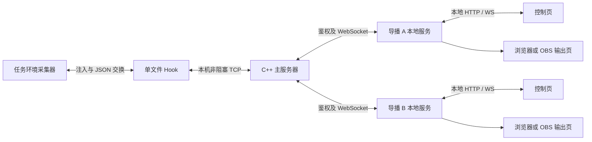

# C++ Web 服务器实施计划

日期：2026-10-16。本文保留整体实施计划；0.2.0 已完成本机 C++ 接收及单文件 Hook 网络闭环，对应第 1～3 阶段。导播本地服务、网页、WS 与账号登录继续后置。实际协议以 [Hook → 主服务器协议](../protocol/hook-server-v1.md) 为准，运行步骤见 [服务器说明](../implementation/server.md)。

本轮落地差异：Boost 1.90.0 官方归档按 SHA-256 锁定，未使用 vcpkg；恢复水位通过 source_open/source_ready 逐源协商；不使用 messageId；结束消息字段名为 latestEventSeq；协议错误记录原因后断开连接。HTTP 暂只提供本机静态 Bearer 凭据保护的只读查询。以下多导播和登录部分仍是后续计划，不代表已交付。

基线为单文件 Hook 0.1.4 和[任务环境协议 v1](../protocol/mission-hook-v1.md)：飞机、导弹及慢字段按 1 Hz 仿真时间采样，Hook 按 1 Hz 真实时间拉取，事件发生时即时冻结并预编码。新服务器直接接收 Hook 网络数据，不读取诊断 JSON/JSONL 文件。

## 1. 首期目标和职责

实现一个独立于 DCS 进程的 C++ 主服务，完成网络接收、事件去重和确认、最新状态缓存、多导播订阅、鉴权、断线恢复与健康检查。首期采用内存模式；不做比赛计分、录像回放、全轨迹存储或正式导播网页。

用户原定的“每个 UI 客户端自己开 Web 服务”落实为每台导播电脑运行一个本地服务进程，浏览器只是该进程的控制页或输出页。一个本地服务可管理多个输出画面，不要求每个浏览器标签页启动一个服务。

| 部件 | 负责内容 | 约束 |
| --- | --- | --- |
| 任务环境 | 对象查询、1 Hz 采样、即时事件缓存和预编码 | 不增加网络、文件或鉴权工作 |
| Hook | 注入、统一拉取、网络发送、处理确认、重连 | 不阻塞 DCS，不因导播数量增加采集次数 |
| C++ 主服务 | 接收及校验、内存缓存、按源去重、订阅分发、认证 | 不逐对象跨环境调用 DCS，不推断未知目标是热焰弹 |
| 导播本地服务 | 登录主服务、保存本机画面配置、分发到本地页面 | 主服务令牌保留在本地服务进程；输出页不持有账号密码 |
| 浏览器控制页 | 选择对象、显示组件、画面布局 | 控制权限制到该导播端 |
| 浏览器或 OBS 输出页 | 显示选定画面 | 只读，不参与上游事件 ACK |

第一轮只实现 C++ 主服务及必要的 Hook 网络适配。导播本地服务和网页作为后续里程碑，先用协议测试客户端验证多端接入。

## 2. 服务组成和技术选择

建议 Windows x64、C++20、CMake；使用 Boost.Asio 处理异步 TCP，Boost.Beast 处理 HTTP/WebSocket，Boost.JSON 解析和构造 JSON。依赖通过 vcpkg 清单锁定版本，实施时验证实际编译器和依赖组合。

Beast 提供基于 Asio 的 HTTP/WebSocket 协议组件，应用仍需自行实现连接生命周期、队列、鉴权和业务逻辑。[Boost 官方说明](https://www.boost.org/doc/libs/latest/libs/beast/doc/html/beast/introduction.html)

| 模块 | 主要职责 |
| --- | --- |
| `HookIngress` | TCP 帧解析、Hook 身份校验、接收预算及连接管理 |
| `SourceRegistry` | 区分 DCS 实例、任务、采集器 epoch，管理当前源及结束源 |
| `TelemetryStore` | 缓存完整最新快照、有限事件历史、确认水位及最终序号 |
| `AckCoordinator` | 连续序号校验、重复事件核对、缺失区间记录和 ACK |
| `SubscriptionHub` | 每个导播端独立订阅、限频、发送队列和恢复游标 |
| `HttpApi` / `AuthService` | 登录、退出、源列表、状态/事件查询、WS 会话认证 |
| `HealthMetrics` | 采集新鲜度、连接、队列、丢弃、ACK 延迟和结束状态 |

首期采用一个网络事件循环和串行化的源状态修改；使用异步 I/O，避免共享数据竞争。若压力测试发现 JSON 处理占用明显，再将编码放入有界工作队列，并保留每源顺序。暂不引入线程池、消息中间件或数据库作为前置条件。

主服务默认与 DCS 同机部署。Hook 接入口仅监听回环地址，例如 `127.0.0.1:9081`；Web 接口示例端口 `9080`，开发时也默认回环。端口均可配置。跨机器导播启用明确配置的 HTTPS/WSS 入口；首期不支持 Hook 通过公网明文 TCP 接入。

## 3. Hook 到主服务

### 3.1 传输与调度

- Hook 主动连接主服务，使用长连接 TCP；服务未启动时 DCS 仍可继续运行。
- 帧格式：4 字节无符号大端长度，加指定字节数的 UTF-8 JSON。必须处理拆包、粘包、部分发送、断线和超长帧；不能以一次 `send` 成功作为完整消息或事件确认。
- 建议单帧上限 512 KiB。大快照按完整实体拆为多帧，带快照编号、页号、总页数；主服务收齐同一快照后才替换当前状态。事件按记录边界拆批，保留现有 eventSeq 和 gaps。
- 每个实体的速度、油量、武器、玩家等属性留在同一个实体记录中。事件和最新状态可同一轮发送，但不要求为了凑齐状态而延迟发送已缓存事件。
- 状态生成/发送正常为 1 Hz；网络收发泵可在帧回调中推进，但每次有字节数、消息数及耗时预算，不额外触发任务采样。初始预算建议每帧收发各 64 KiB、4 个完整帧、约 1 ms，属于调优目标；单次系统调用/编码仍须实测耗时，不能把预算宣称为硬实时保证。
- 非阻塞连接、发送和接收；超时为 0，避免同步 DNS，首期使用回环 IP。重连退避建议从 0.5 秒增加至 10 秒。
- LuaSocket 的非阻塞和部分收发语义以官方接口为依据；安装目录已发现 LuaSocket 文件，但必须在真实 Hook 环境验证模块是否可用。若不可用，应明确报网络不可用，不通过解除任务环境沙箱补救。[LuaSocket TCP 文档](https://lunarmodules.github.io/luasocket/tcp.html)

### 3.2 外层消息与字段

沿用任务协议中的实体和事件定义，另设网络封装版本 `transportVersion=1`，不要修改任务协议 `protocolVersion` 来表达网络版本。

| 字段 | 含义 |
| --- | --- |
| `transportVersion` | 网络协议版本 |
| `type` | 消息类型 |
| `connectionId` | 主服务握手分配的本次连接身份，用于拒绝旧连接残留响应 |
| `source` | `{instanceId, missionSessionId, collectorEpoch}`；任务会话及 epoch 沿用现有采集器，`instanceId` 是额外的 DCS 安装实例标识 |
| `messageId` | 连接内消息序号或请求关联 ID；不替代 eventSeq |
| `payload` | 该类消息数据 |

`source` 表中：`missionSessionId` 和 `collectorEpoch` 为已有的任务源二元组；`instanceId` 由部署配置指定并绑定 Hook 凭据。事件唯一键为完整 source 加 eventSeq，实体唯一键为完整 source 加 entityId。所有 ID 保持字符串，不能根据名称或 dcsObjectId 跨任务拼接对象。

| 消息 | 方向 | 主要内容 |
| --- | --- | --- |
| `hello` | Hook → 服务 | 版本、实例身份、Hook 凭据、当前及保留源的可重发范围和确认水位 |
| `welcome` | 服务 → Hook | connectionId、serverEpoch、ackMode、各源接收水位、限制 |
| `snapshot` | Hook → 服务 | 完整对象记录分页、snapshotId、assembledSimTime、eventSeqAtCapture、coverage |
| `events` | Hook → 服务 | afterSeq、throughSeq、latestEventSeq、events、gaps |
| `ack` | 服务 → Hook | source、serverEpoch、ackMode、ackEventSeq |
| `status` | Hook → 服务 | 暂停、采集健康度、读取/确认位置和队列占用 |
| `session_end` | Hook → 服务 | finalEventSeq、Hook 的 tailComplete/tailReason |
| `session_end_received` | 服务 → Hook | 已保存结束元数据；与事件 ACK 分开 |
| `ping` / `pong` | 双向 | 连接存活信息，不代表事件确认 |
| `error` / `resync_required` | 服务 → Hook | 错误码、所属源、恢复位置和原因 |

首期不允许主服务或导播端通过该接口执行任意 Lua、切换任务或改变 DCS 对象。

### 3.3 对接现有 Bridge

复用 `getPendingBatches(source)`、`getRetainedSessions()`、`latestState` 和 `confirm(source, sequence)`。网络适配器在 Bridge 已将事件加入 pending 队列后取数，不在 `sink:onEvents` 中同步等待服务端 ACK；该回调发生在 readThrough 推进之前，过早确认会被拒绝。

每个事件批次编码成网络帧后保留发送位置；重连可重新发送未确认帧，不逐帧重新编码。任务环境的预编码已减少 mission→Hook 成本，但 Hook 接口当前返回的是解码后的表，因此 Hook→服务器外层仍需编码一次，不能宣称端到端零编码。

状态只保留最新待发完整快照；已经开始发送的帧必须完成或关闭连接，不能中途替换剩余字节。事件按 pending 重发，不创建另一份无上限队列。结束元数据需要单独的有界待确认队列，因为现有 `onSessionEnd` 回调返回成功并不证明远端收到。

继续打包为一个 Hook 文件，网络适配源码内嵌。新增连接地址、实例凭据及网络预算配置；主服务上线后诊断文件默认关闭，是否启用由显式调试配置控制。

## 4. 内存接收、确认与恢复

### 4.1 明确修改现有 ACK 契约

早期架构曾将 C++ ACK 定义为“已持久保存”。0.2.0 已同步修订架构和协议，按不依赖数据文件的方向采用显式协商的 `ackMode=memory`：ACK 只表示主服务已校验并纳入本次进程的权威内存缓存，允许 Hook 和任务环境释放对应日志。**不保证主服务进程退出后的事件恢复。**

实施第 1 阶段必须同步修订相关 ACK 文档并增加模式/epoch 校验，再接通自动 `confirm`；不能给当前“持久确认”语义直接塞入内存 ACK。若以后需要持久接收，另实现 `ackMode=durable` 和事务提交后确认，本期不引入数据库。

状态快照是可覆盖的当前值，不参与事件 ACK。慢导播端的接收进度与上游 ACK 解耦，一个断线导播不能阻塞 DCS 数据接收。

### 4.2 连续确认和去重

1. 验证凭据、源身份、类型、长度和序号范围。
2. 同源 eventSeq 相同且规范化内容一致视为重发，不再次触发业务或重复广播；内容不同报冲突，不能静默覆盖。缓存保留期内校验正文或内容摘要；早于保留范围的已确认序号仅作为旧重发忽略，不声称仍能逐字核对。
3. 将事件和显式 gap 写入该源有界缓存；只有连续覆盖到的序号才可推进 ACK。显式 gap 代表已知数据丢失，推进水位不能抹去缺失告警。
4. ACK 必须绑定 source、serverEpoch 和 ackMode。Hook 只把匹配且不超过 readThrough 的确认交给 `Bridge:confirm`；旧任务确认只释放旧源队列。
5. 空批次、重发、ACK 丢失及重复 ACK 均不产生新事件。后来的 ACK 不得倒退水位。

### 4.3 断线与重启边界

- **连接断开、主服务未重启：** serverEpoch 不变，握手返回当前连续接收位置；Hook 重发尚未确认部分。ACK 丢失导致的重复由服务端去重。
- **主服务重启：** 生成新的 serverEpoch，所有连接和会话失效。Hook 报告可重发的最早位置；已按 memory ACK 释放的历史不能找回。服务登记明确的 `server_restart` 历史缺口/恢复基线，再接收仍保留的事件和最新完整快照，不能假装从 1 开始完整恢复，也不能倒退 Collector 已接受的 ACK。
- **DCS/Hook 进程退出：** 未送入主服务的内存数据可能丢失。仅网络重连可恢复的保证不能扩展为进程崩溃恢复。
- **任务切换：** 新旧 source 并存；公平调度旧源未确认事件和新源数据。旧源最终元数据独立重传，收到旧源尾部不能覆盖新任务当前画面。

恢复握手、缺口确认和源绑定需在实施时形成独立网络协议文档及状态机；未完成之前不得打开自动 ACK。

### 4.4 三种结束状态

| 状态 | 判断 |
| --- | --- |
| 采集侧已读齐 | Hook 的 readThrough 达到 finalEventSeq，tailComplete=true |
| 主服务已接收齐 | 主服务连续接收位置达到 finalEventSeq，并收到 session_end |
| 事件历史无缺失 | 上述成立且该源没有缓冲溢出、重启恢复缺口或其他 gap |

这些状态分别展示。接收齐不等于持久保存，也不等于每个导播已经显示完。Hook 停止任务后，网络发送仍在有界帧泵内继续，不在停止回调中阻塞等待服务器。

## 5. 多导播接口与权限

### 5.1 HTTP 与 WebSocket

| 接口草案 | 用途 |
| --- | --- |
| `GET /healthz` | 最小存活信息，不暴露比赛数据或凭据 |
| `POST /api/v1/auth/login` | 导播本地服务提交凭据，获得短期会话令牌 |
| `POST /api/v1/auth/logout` | 撤销会话及其 WS 连接 |
| `GET /api/v1/sources` | 列出有权限访问的数据源及生命周期 |
| `GET /api/v1/sources/{sourceId}/snapshot` | 最新完整对象状态，携带快照时间和事件水位 |
| `GET /api/v1/sources/{sourceId}/events?afterSeq=...&limit=...` | 有界事件分页；早于保留范围返回明确恢复提示 |
| `GET /api/v1/status` | 已授权范围内的健康与连接状态 |
| `GET /ws/v1/telemetry` | 升级为持续订阅连接 |

主服务返回不透明的 `sourceId` 供 URL 使用，并在响应中保留完整 source 身份，避免客户端自行拼接三段 ID。

WS 支持 `subscribe`、`unsubscribe`、`snapshot`、`events`、`source_status`、`resync_required`。首期只按 source 订阅全部实体和事件，默认最新状态最多 1 Hz；事件随接收批次推送。按飞机/队伍过滤留到后续，避免过滤后破坏全源连续游标语义。

首次订阅在源的串行执行上下文中固定快照和事件水位，先发基线，再接续直播。重连时以 afterSeq 补发保留期内事件；无法补齐则明确通知重新建立基线。状态带 eventSeqAtCapture，不允许用迟到的旧事件重新创建已从较新快照移除的对象。画面中是否重播历史提示由导播端决定。

### 5.2 登录和画面隔离

角色至少区分 `hook_ingest`、`director`、`viewer`、`admin`。Hook 凭据只能上传绑定实例的数据；director 可订阅授权源并管理自己的输出；viewer 只读；admin 管理账号和授权。角色来自服务器配置，不能信任客户端自报。

首期账号由管理员预配置，不开放注册。密码使用成熟库提供的密码哈希方案，登录限速，令牌有到期和撤销机制，日志不记录密码/令牌。具体库及参数在协议阶段固定。

导播本地服务持有主服务会话令牌，连接远端 WSS 时使用认证头。后续若允许浏览器直接访问，采用同源安全会话及 WS Origin 校验；不把长期令牌放进查询 URL。远端传输必须使用 TLS，可由明确配置的反向代理终止，主服务仅信任指定代理。

每个本地输出用 `outputId` 管理，例如主画面、飞机详情、导弹跟踪。本地服务保存所选 source、entityId、组件和布局；A 导播修改不影响 B。OBS 输出页只取得该输出的只读本地访问权限。本地服务默认绑定回环并校验 Host/Origin，不能假定 localhost 无需访问控制。

## 6. 缓存、背压与性能

以下为首期可调初值，须通过压力测试确认，不是已达到的性能承诺。

| 项目 | 初始约束 |
| --- | --- |
| 状态分发 | 1 Hz；相同订阅复用已编码快照 |
| 每源事件历史 | 最多 10,000 条或 16 MiB 编码量，任一先到淘汰最旧已接收历史 |
| 全局事件历史 | 最多 64 MiB 编码量；同时限制源数量，不能靠增加 source 绕过总上限 |
| 单快照组装 | 最多 8 MiB、64 帧，10 秒未收齐丢弃暂存并请求重同步 |
| 导播发送队列 | 每连接最多 4 MiB；状态只留最新，事件不能静默跳过 |
| 慢导播 | 超限发送恢复提示或断开，随后按游标恢复；不阻塞其他客户端 |
| 缓存过期 | 响应给出最早保留序号，过旧游标必须重同步 |
| 心跳 | 约 5 秒一次，约 15 秒无响应判离线；与游戏暂停区分 |
| 健康指标 | 输入/输出字节、处理耗时、队列容量、事件水位、ACK 延迟、缺口和快照年龄 |

历史淘汰是服务的保留策略，不追溯撤销已发送的 memory ACK；慢消费者因此失去回放范围时必须得知。内存不足以接受新数据时停止推进 ACK 并施加背压，不报成功后丢弃尚未纳入权威缓存的事件。

快照新鲜度分别展示真实接收时间和仿真采样时间。暂停期间仿真时间停止，不能仅凭仿真时间判网络失联。浏览器可独立插值动画，但插值值不得标成新增 DCS 实测样本。

当前 Bridge 每轮最多读取 128 个事件/缺口项，正常 1 Hz 时理论上限为每秒 128 项，实际还受响应字节预算和状态分页影响。短时突发先进入已有缓存，之后逐批追赶；不能承诺持续每秒 500 条事件不积压。如实际比赛超过此范围，优先评估增大单次事件批量及字节预算，而不擅自提高已确定的 1 Hz 状态采集频率。

## 7. 实施顺序和验收

| 阶段 | 交付 | 验收标准 |
| --- | --- | --- |
| 1 协议和服务骨架 | CMake 工程、配置、TCP/HTTP 服务、memory ACK 契约及恢复状态机 | 能独立启动停止；帧解析、超长帧、错误 JSON、版本/身份拒绝测试通过 |
| 2 接收和确认 | 内存源仓库、去重、连续 ACK、gap、结束元数据 | 重发不重复广播；缺号不越界确认；冲突内容拒绝；服务重启明确历史缺口 |
| 3 Hook 网络适配 | 内嵌传输模块、1 Hz 数据发送、非阻塞收发和重连 | 断网不阻塞 DCS；部分收发正确；ACK 释放正确源缓存；单文件部署仍成立 |
| 4 多端与鉴权 | 登录、源权限、WS 订阅、恢复和慢端隔离 | 两个独立测试客户端收到同源数据；一个慢端不影响另一个；越权被拒绝 |
| 5 实机与压力验收 | 故障注入、指标、部署文档 | 正常结束补齐；旧任务 ACK 不影响新任务；进程重启按 memory 契约恢复；记录 DCS 帧时间对照 |
| 6 导播端和网页 | 每台导播的本地服务、控制页、输出页 | 多画面独立控制，账号凭据不进入 OBS 输出页；另行细化 UI 方案 |

性能测试场景建议覆盖 100 架飞机、300 枚活跃导弹的合成 1 Hz 状态，8 个订阅端，以及每秒 500 条事件的短时突发。记录 CPU、进程内存、处理延迟和 ACK 延迟，确认有界队列行为；合成测试不能代替 DCS 实机帧时间对比。

故障验收至少包括：服务未启动、TCP 中断/半帧、ACK 丢失、客户端慢读、服务重启、任务结束时断线、快速切换任务、缓存满、事件 gap、快照缺页、错误凭据和未授权源。DCS 侧保留已验证的目标身份、事件武器分类和结束补拉回归。

首个可运行版本的完成标准是：单文件 Hook 通过网络送入 C++，主服务在明确的 memory ACK 契约下确认，两个独立客户端能查看同一份完整对象属性和连续事件，断线/结束/重启状态如实可见。正式 UI 与比赛业务随后实现。
